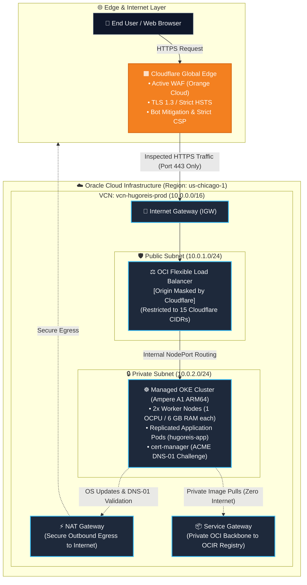
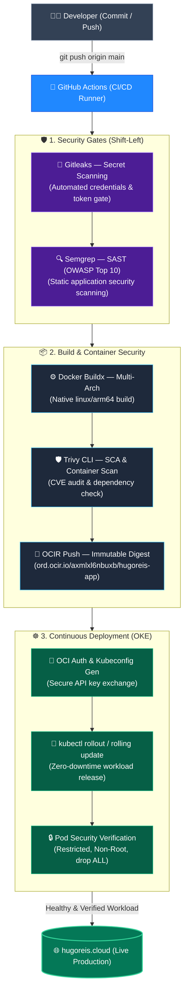

  <a href="README.md"><b>🇺🇸 English</b></a> | <a href="README.pt-BR.md"><b>🇧🇷 Switch to Portuguese</b></a>

# 🛡️ hugoreis.cloud — MultiCloud Infrastructure & DevSecOps

  
  
  
  
  

  
  
  
  
  
  
  

---

## 🌐 Production Environment
* **Live Domain:** [https://www.hugoreis.cloud](https://www.hugoreis.cloud)
* **Edge & DNS Resolution:** Cloudflare Global Anycast Edge with Strict TLS 1.3 and automated ACME renewal via cert-manager.
* **Cloud Origin:** Oracle Cloud Infrastructure (OCI) — Region `us-chicago-1`.
* **Architectural Philosophy:** Perimeter Zero Trust, corporate network isolation, and automated Shift-Left security validation.

---

## 🏛️ Cloud Architecture Topology (Zero Trust on OCI)

Inbound traffic never reaches compute workloads directly. The infrastructure implements multi-tiered defense and network segmentation across public and private subnets:

📐 Network Topology Blueprint
---
## ⚙️ Technical Specifications

| Component | Technology | Configuration / Sizing |
| :--- | :--- | :--- |
| **Cloud Provider** | Oracle Cloud Infrastructure (OCI) | Region: `us-chicago-1` |
| **Orchestrator** | Kubernetes (OKE) | Version: 1.37 (Managed Control Plane) |
| **Compute Nodes** | Ampere A1 (ARM64) | 2 Nodes (1 OCPU, 6 GB RAM each — 2 OCPUs / 12 GB RAM total) |
| **Load Balancer** | OCI Flexible Load Balancer | Internal NodePort routing |
| **Edge / DNS / WAF** | Cloudflare | Active Proxy + Strict TLS 1.3 |
| **SSL Certificates** | cert-manager + Let's Encrypt | Automated renewal via DNS-01 |
| **CI/CD Pipeline** | GitHub Actions | Multi-arch build and zero-downtime deployment |
---
## 🏗️ DevSecOps Delivery Pipeline (Shift-Left CI/CD)
The continuous integration and delivery pipeline automatically enforces security gates across source code, third-party packages, and container images prior to cluster deployment:

---
## 👨‍💻 Author: Hugo Reis
Cloud Infrastructure & Network Security Engineer

- 💼 LinkedIn: linkedin.com/in/hugo-nogueira-dos-reis
- 🌐 Portfolio: hugoreis.cloud
- 🐙 GitHub: github.com/hnreis
