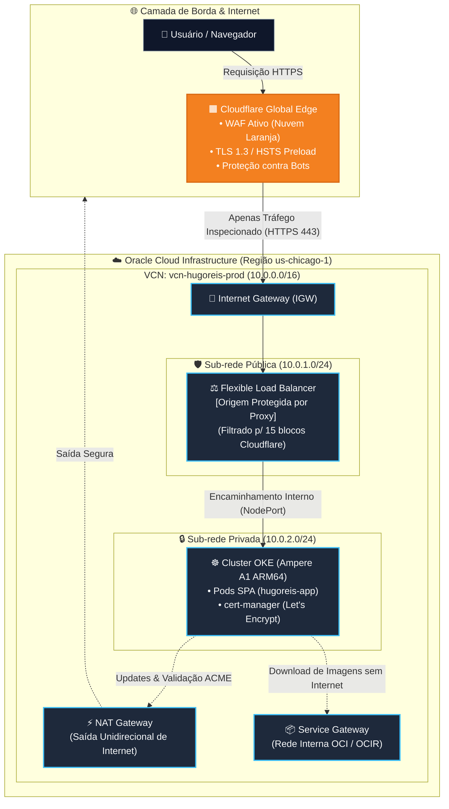

# Production MultiCloud Architecture & Bilingual SPA

<p align="center">
  
  
  
  
  
</p>

---

## 🌐 Endereço de Produção
* **Domínio Oficial:** [https://hugoreis.cloud](https://hugoreis.cloud)
* **Borda & DNS:** Cloudflare Edge com TLS 1.3 estrito e renovação automática via cert-manager.
* **Provedor de Nuvem (Origem):** Oracle Cloud Infrastructure (OCI) — Região `us-chicago-1`.

---

## 🏛️ Topologia de Arquitetura de Nuvem

O tráfego de usuários não acessa os servidores de computação diretamente. A infraestrutura adota isolamento perimetral em camadas:


---

🚀 Esteira Automatizada de CI/CD (GitHub Actions)

A cada integração na branch main, o pipeline executa o ciclo completo de entrega contínua em formato vertical sem intervenção manual:

```mermaid
flowchart TD
    Dev["👨‍💻 Dev (Hugo)"] -->|"git push origin main"| GH["🐙 GitHub Actions"]

    subgraph CI ["Integração Contínua (CI)"]
        direction TB
        Checkout["1. Checkout do Código"] --> QEMU["2. Configuração QEMU & Buildx"] --> Build["3. Build Nativo ARM64 (Ampere A1)"] --> Push["4. Push no OCIR (ord.ocir.io)<br/>• Tag Git SHA<br/>• Tag :latest"]
    end

    subgraph CD ["Entrega Contínua (CD)"]
        direction TB
        Auth["5. Autenticação OCI CLI"] --> Kube["6. Kubeconfig Dinâmico OKE"] --> Deploy["7. kubectl set image (hugoreis-app)"] --> Rollout["8. Validação de Saúde (Zero Downtime)"]
    end

    GH --> CI
    CI --> CD
    CD -->|"Workload Atualizado com Sucesso"| OKE[("☸️ Cluster OKE em Produção")]

    classDef dev fill:#334155,stroke:#94a3b8,color:#fff;
    classDef gh fill:#2088ff,stroke:#1d4ed8,color:#fff;
    classDef steps fill:#1e293b,stroke:#38bdf8,stroke-width:1px,color:#f8fafc;
    classDef prod fill:#059669,stroke:#10b981,stroke-width:2px,color:#fff;

    class Dev dev;
    class GH gh;
    class Checkout,QEMU,Build,Push,Auth,Kube,Deploy,Rollout steps;
    class OKE prod;
