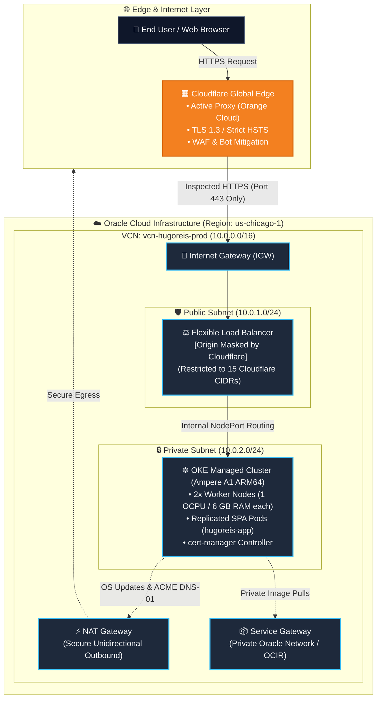

<p align="center">
  <a href="README.md"><b>🇺🇸 English</b></a> | <a href="README.pt-BR.md"><b>🇧🇷 Português</b></a>
</p>

# Production-Grade MultiCloud Infrastructure & Bilingual SPA

<p align="center">
  
  
  
  
  
</p>

---

## 🌐 Production Environment
* **Live Domain:** [https://www.hugoreis.cloud](https://www.hugoreis.cloud)
* **Edge & DNS:** Cloudflare Edge with Strict TLS 1.3 and automated Let's Encrypt certificates via cert-manager.
* **Cloud Origin:** Oracle Cloud Infrastructure (OCI) — Region `us-chicago-1`.

---

## 🏛️ Cloud Architecture Topology

Inbound traffic never reaches compute workloads directly. The infrastructure implements multi-tiered perimeter defense and network isolation:


```mermaid
flowchart TD
    Dev["👨‍💻 Engineer (Hugo Reis)"] -->|"git push origin main"| GH["🐙 GitHub Actions Pipeline"]

    subgraph CI ["Continuous Integration (CI)"]
        direction TB
        Checkout["1. Source Code Checkout"] --> QEMU["2. Setup QEMU & Docker Buildx"] --> Build["3. Native ARM64 Build (Ampere A1)"] --> Push["4. Push to OCI Registry (ord.ocir.io)<br/>• Immutable Git SHA Tag<br/>• :latest Tag"]
    end

    subgraph CD ["Continuous Deployment (CD)"]
        direction TB
        Auth["5. Authenticate OCI CLI (API Key)"] --> Kube["6. Dynamic OKE Kubeconfig"] --> Deploy["7. kubectl set image (hugoreis-app)"] --> Rollout["8. Healthcheck & Zero Downtime Validation"]
    end

    GH --> CI
    CI --> CD
    CD -->|"Workload Updated Successfully"| OKE[("☸️ Production OKE Cluster")]

    classDef dev fill:#334155,stroke:#94a3b8,color:#fff;
    classDef gh fill:#2088ff,stroke:#1d4ed8,color:#fff;
    classDef steps fill:#1e293b,stroke:#38bdf8,stroke-width:1px,color:#f8fafc;
    classDef prod fill:#059669,stroke:#10b981,stroke-width:2px,color:#fff;

    class Dev dev;
    class GH gh;
    class Checkout,QEMU,Build,Push,Auth,Kube,Deploy,Rollout steps;
    class OKE prod;
