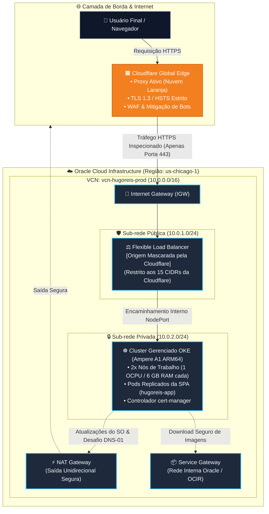
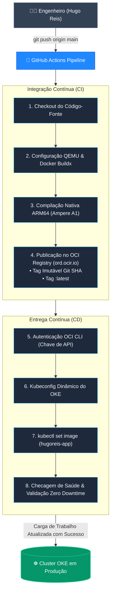

  <a href="README.md"><b>🇺🇸 English</b></a> | <a href="README.pt-BR.md"><b>🇧🇷 Português</b></a>

# Infraestrutura MultiCloud de Produção & SPA Bilíngue

  
  
  
  
  

---

## 🌐 Ambiente de Produção
* **Domínio Oficial:** [https://www.hugoreis.cloud](https://www.hugoreis.cloud)
* **Borda & DNS:** Borda global Cloudflare com TLS 1.3 estrito e renovação automática de certificados Let's Encrypt via cert-manager.
* **Provedor de Nuvem (Origem):** Oracle Cloud Infrastructure (OCI) — Região `us-chicago-1`.

---

## 🏛️ Topologia de Arquitetura de Nuvem

O tráfego de entrada nunca atinge as cargas de trabalho de computação diretamente. A infraestrutura adota defesa perimetral em camadas e isolamento de rede:

---
## 🚀 Esteira Automatizada de CI/CD (GitHub Actions)
A cada commit enviado para a branch main, a esteira executa o ciclo completo de entrega contínua sem tempo de inatividade (Zero Downtime):

---
## 🛡️ Pilares Centrais de Segurança & Engenharia (Zero Trust)
1. Mascaramento de Origem e Anti-WAF Bypass
- Nuvem Laranja da Cloudflare: O IP público de origem do Load Balancer da Oracle permanece estritamente oculto. Todas as consultas DNS externas resolvem exclusivamente os endereços Anycast da Cloudflare.
- Firewall Perimetral Restritivo: A porta 443 da Sub-rede Pública autoriza conexões originadas estritamente dos 15 blocos CIDR oficiais da Cloudflare. Varreduras automatizadas e tentativas de acesso direto ao IP de origem são descartadas no perímetro.

2. Isolamento de Computação em Sub-rede Privada
- Os nós de trabalho do Kubernetes residem em uma sub-rede privada (10.0.2.0/24) sem IPs públicos atribuídos.
- O tráfego de saída utiliza um NAT Gateway dedicado (unidirecional, apenas saída), e os downloads de contêineres do OCI Registry (OCIR) trafegam internamente pela rede da Oracle através de um Service Gateway.

---
## 👨‍💻 Autor
## Hugo Reis
Cloud Infrastructure & Network Security Engineer

- 💼 LinkedIn: linkedin.com/in/hugo-nogueira-dos-reis
- 🌐 Portfólio: hugoreis.cloud
