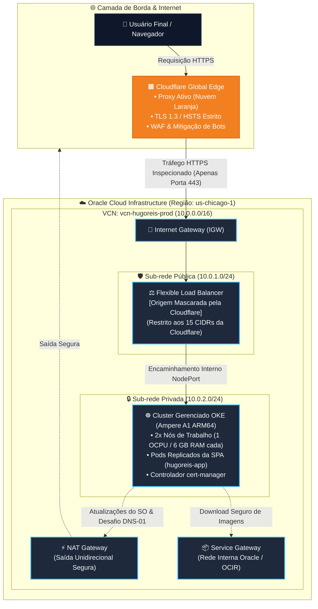
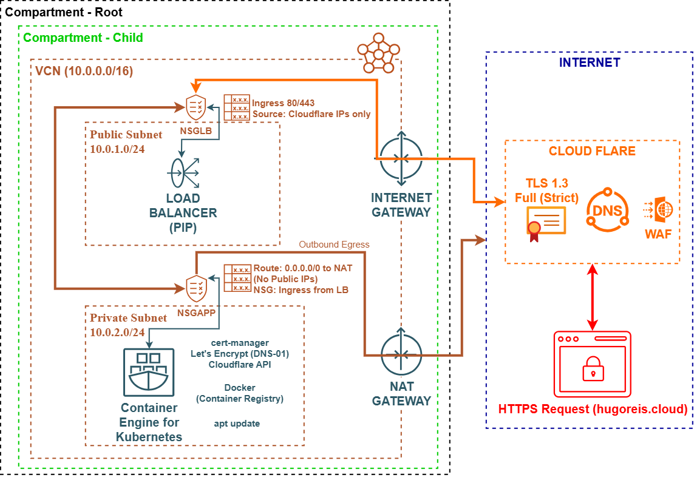
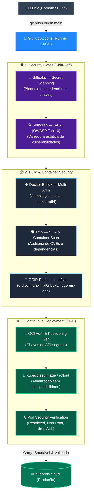

  <a href="README.md"><b>🇺🇸 English</b></a> | <a href="README.pt-BR.md"><b>🇧🇷 Português</b></a>

# Infraestrutura MultiCloud de Produção & SPA Bilíngue

  
  
  
  
  

---

## 🌐 Ambiente de Produção
* **Domínio Oficial:** [https://www.hugoreis.cloud](https://www.hugoreis.cloud)
* **Borda & DNS:** Borda global Cloudflare com TLS 1.3 estrito e renovação automática de certificados Let's Encrypt via cert-manager.
* **Provedor de Nuvem (Origem):** Oracle Cloud Infrastructure (OCI) — Região `us-chicago-1`.

---

## 🏛️ Topologia de Arquitetura de Nuvem

O tráfego de entrada nunca atinge as cargas de trabalho de computação diretamente. A infraestrutura adota defesa perimetral em camadas e isolamento de rede:

---
## 📐Blueprint Esquemático de Rede & Fronteiras de Segurança

  

---
# 🛡️ hugoreis.cloud — Infraestrutura MultiCloud & DevSecOps

-success)

[🇺🇸 Switch to English](README.md) | [🌐 Aceder à Aplicação em Produção](https://www.hugoreis.cloud)

Ambiente corporativo de produção executado na **Oracle Cloud Infrastructure (OCI)** e na borda da **Cloudflare**, desenhado sob os princípios de **Zero Trust**, **Shift-Left Security** e orquestração gerenciada com **Kubernetes (OKE)** em nós nativos ARM64 (Ampere A1).

---

## 🏗️ Topologia da Esteira DevSecOps (Shift-Left Pipeline)

A esteira de integração e entrega contínua (CI/CD) valida a segurança do código, dependências e contentores antes de autorizar a implementação no cluster:

---
## 🛡️ Pilares Centrais de Segurança & Engenharia (Zero Trust)
1. Mascaramento de Origem e Anti-WAF Bypass
- Nuvem Laranja da Cloudflare: O IP público de origem do Load Balancer da Oracle permanece estritamente oculto. Todas as consultas DNS externas resolvem exclusivamente os endereços Anycast da Cloudflare.
- Firewall Perimetral Restritivo: A porta 443 da Sub-rede Pública autoriza conexões originadas estritamente dos 15 blocos CIDR oficiais da Cloudflare. Varreduras automatizadas e tentativas de acesso direto ao IP de origem são descartadas no perímetro.

2. Isolamento de Computação em Sub-rede Privada
- Os nós de trabalho do Kubernetes residem em uma sub-rede privada (10.0.2.0/24) sem IPs públicos atribuídos.
- O tráfego de saída utiliza um NAT Gateway dedicado (unidirecional, apenas saída), e os downloads de contêineres do OCI Registry (OCIR) trafegam internamente pela rede da Oracle através de um Service Gateway.
---
## ⚙️ Especificações Técnicas

| Componente | Tecnologia | Configuração / Dimensionamento |
| :--- | :--- | :--- |
| **Provedor de Nuvem** | Oracle Cloud Infrastructure (OCI) | Região `us-chicago-1` |
| **Orquestrador** | Kubernetes (OKE) | Versão: 1.37 (Control Plane Gerenciado) |
| **Nós de Computação** | Ampere A1 (ARM64) | 2 Nós (1 OCPU, 6 GB RAM cada — total de 2 OCPUs / 12 GB RAM) |
| **Balanceador** | OCI Flexible Load Balancer | Roteamento interno via NodePort |
| **Borda / DNS / WAF** | Cloudflare | Proxy Ativo + TLS 1.3 Estrito |
| **Certificados SSL** | cert-manager + Let's Encrypt | Renovação automática via DNS-01 |
| **Pipeline de CI/CD** | GitHub Actions | Compilação multi-arquitetura e deploy zero downtime |

---
## 👨‍💻 Autor
## Hugo Reis
Cloud Infrastructure & Network Security Engineer

- 💼 LinkedIn: linkedin.com/in/hugo-nogueira-dos-reis
- 🌐 Portfólio: hugoreis.cloud
